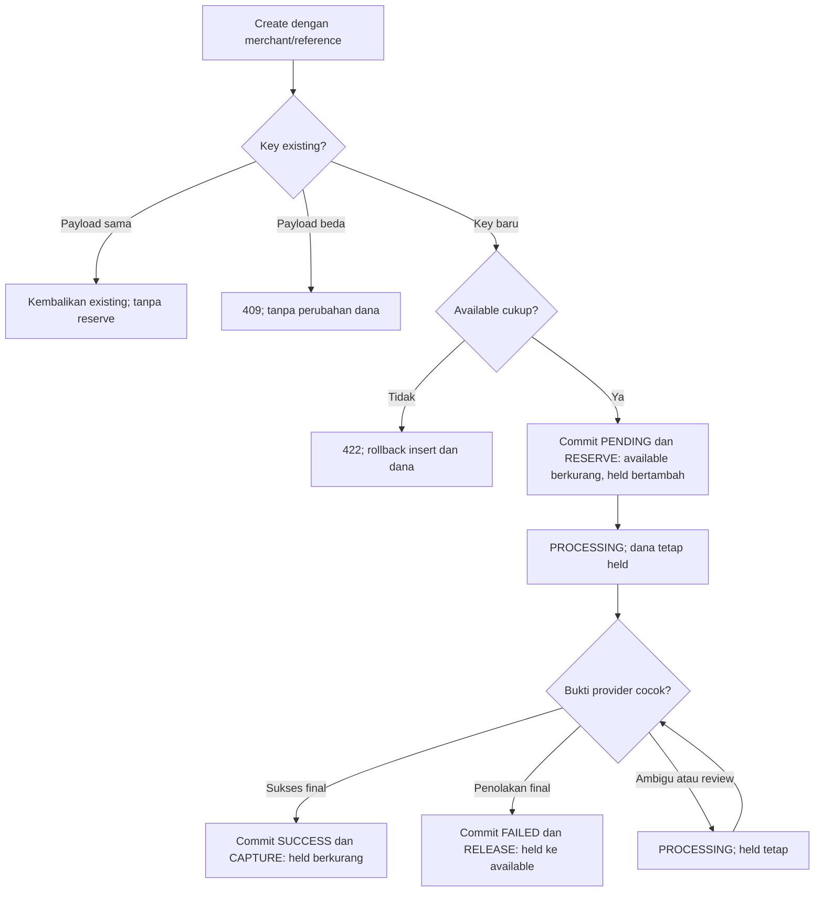

# Alur transfer dan dana

Diagram menggambarkan implementasi saat ini, bukan kontrak bank nyata. DB aplikasi dan DB bank terpisah. Inquiry menggunakan akun/provider reference yang sudah disimpan. [Source recovery](../internal/transfer/recovery.go), [dana](../internal/transfer/funds.go), [kontrak](provider-contract.md).

## Transfer normal

```mermaid
sequenceDiagram
    participant C as Merchant
    participant A as API
    participant D as PostgreSQL aplikasi
    participant W as Worker
    participant B as Mock bank durable
    C->>A: POST /transfers + reference_id
    A->>D: BEGIN; insert transfer/reference/job; reserve; movement
    D-->>A: COMMIT PENDING / HELD
    A-->>C: 201 + ID/provider_reference
    W->>D: Claim, token, expiry, attempt
    D-->>W: COMMIT PROCESSING; lock dilepas
    W->>B: Inquiry reference existing
    B-->>W: NOT_FOUND + scope/epoch
    W->>D: Simpan/verifikasi guard resubmit
    D-->>W: COMMIT
    W->>B: Submit reference/payload sama + guard
    B-->>W: 200 SUCCEEDED setelah commit bank
    W->>D: BEGIN; cek lease; SUCCESS + CAPTURE + evidence
    D-->>W: COMMIT; job selesai
    C->>A: GET /transfers/ID
    A-->>C: SUCCESS / CAPTURED
```

Diagram memakai worker. Dispatch manual memakai claim/fencing yang sama, sedangkan create tidak melakukan HTTP bank. Worker aktif dapat bergerak sebelum client membaca 201.

## Bank sukses tetapi respons 504

```mermaid
sequenceDiagram
    participant W as Dispatch / worker
    participant D as PostgreSQL aplikasi
    participant B as Mock bank durable
    W->>D: Commit claim/reference/epoch sebelum submit
    Note over W,D: Lock dilepas sebelum HTTP
    W->>B: Submit reference/payload existing
    B->>B: COMMIT SUCCEEDED
    B-->>W: HTTP 504
    W->>D: PROCESSING / HELD + next_attempt_at
    Note over W,D: Jadwal tetap ada setelah restart
    W->>D: Claim inquiry jatuh tempo + token baru
    D-->>W: COMMIT; lock dilepas
    W->>B: GET status reference existing
    B-->>W: 200 SUCCEEDED + payload cocok
    W->>D: Cek token/expiry; SUCCESS + CAPTURE + evidence
    D-->>W: COMMIT atomik
```

Claim yang crash meninggalkan pekerjaan pada lease expiry. Tidak ada transfer/reference baru untuk mengatasi timeout. Worker lama ditolak oleh token/expiry saat mencoba commit hasil.

## Reservasi, capture, dan release



Semua perubahan nominal memakai integer rupiah. Status final, state dana, movement, evidence/audit, dan job commit bersama. Dispatch, inquiry, dan rekonsiliasi memakai `settleFunds`; unique index `fund_settle_once` membatasi satu CAPTURE atau RELEASE per transfer. Diagram ini berlaku pada transfer baru dengan reservasi, bukan data `LEGACY`.
