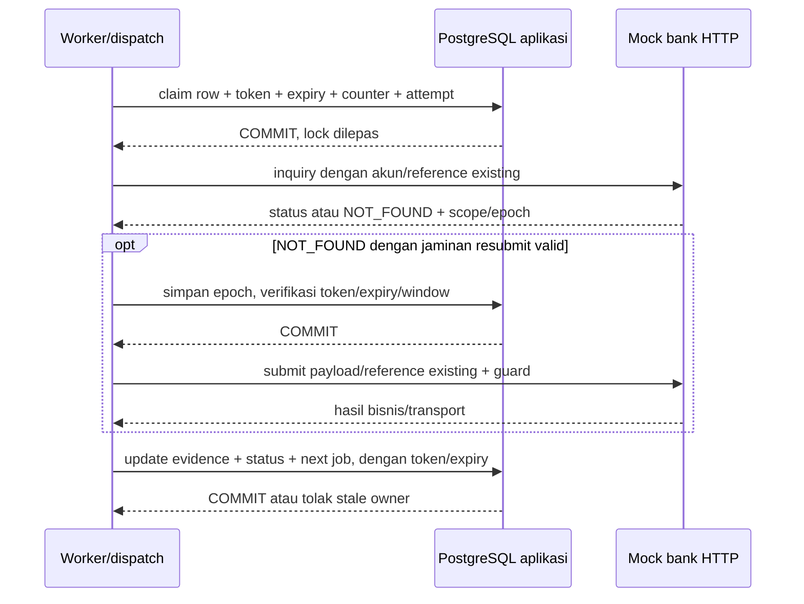

# Recovery tahap 4

## Model dan batas transaksi

Semua state pekerjaan berada pada row transfers: job_kind, next_attempt_at, recovery_attempts/max_attempts, lease_token/until, last_error, needs_review/review_reason, retention_epoch, dan resubmit_before. INSERT transfer memberi default jadwal SUBMIT dan window 15 menit pada statement yang sama. Algoritma idempotency merchant tetap INSERT ON CONFLICT (merchant_id,reference_id) DO NOTHING RETURNING id lalu SELECT terpisah; tidak ada enqueue tambahan atau reference baru.

cmd/worker memproses PENDING untuk pengiriman awal, serta PROCESSING jatuh tempo untuk inquiry. Claim memakai transaksi READ COMMITTED pendek, SELECT FOR UPDATE SKIP LOCKED, token acak baru, dan expiry dari clock PostgreSQL. Status PROCESSING, attempt journal, increment counter, job_kind=INQUIRY dan jadwal pada expiry lease committed sebelum HTTP. Karena jenis pekerjaan berubah sebelum HTTP, restart setelah claim selalu mengutamakan inquiry.



Setiap update hasil mengunci row sebentar, lalu memeriksa token dan lease_until > clock_timestamp() pada UPDATE terakhir sebelum commit. Jika fence gagal, seluruh transaksi di-rollback, termasuk update journal. Worker lama tidak dapat mengubah status, jadwal, last_error, review, atau melepas lease worker baru. Reclaimer menutup journal STARTED yang ditinggalkan sebagai AMBIGUOUS/LEASE_EXPIRED. HTTP tidak berjalan di dalam transaksi aplikasi.

Final status hanya dari body SUCCEEDED/REJECTED yang cocok dengan akun/reference/payload dan kontrak provider. Evidence dan status final commit bersama; status final tidak turun. Bukti berlawanan dari owner yang masih valid dicatat FINAL_CONFLICT dan perlu review. Hasil dari token lama ditolak sebelum menulis state.

## Retry, budget, dan shutdown

- Default: lease 30s, poll 500ms, base backoff 1s, cap 1m. Delay setiap retry berada di [cap/2,cap], dengan cap=min(base*2^(claim-1),maximum). Nilai delay dipilih sekali dan due time disimpan berdasarkan clock DB.
- Budget default 8 claim pada recovery_max_attempts, bukan 8 HTTP request. Dispatch awal, claim yang crash, dan inquiry ikut dihitung. Satu claim dapat melakukan satu inquiry dan satu submit bersyarat. kind pada journal menyatakan jenis tugas utama, bukan bukti bahwa HTTP sudah sampai ke bank.
- Crash sebelum pencatatan hasil tetap meninggalkan jadwal pada expiry lease. Budget habis tidak mengubah status menjadi FAILED: PROCESSING dipertahankan, needs_review=true dan review_reason=RETRY_BUDGET_EXHAUSTED, tanpa jadwal otomatis berikutnya.
- Saat SIGTERM/Ctrl+C, worker berhenti claim. Context membatalkan HTTP aktif; penyimpanan observasi diberi DB_TIMEOUT terpisah. Tidak ada pekerjaan hanya di memory. SIGKILL dipulihkan dari state durable setelah lease habis.
- Lease tidak memakai heartbeat. Pilih lease lebih panjang dari dua timeout HTTP dan tiga budget DB untuk operasi normal. Request lama masih bisa aktif setelah expiry; deduplikasi bank menjaga satu operasi efektif ketika HTTP overlap.

RECOVERY_* mengatur cmd/worker. Dispatch manual memakai default policy yang sama dengan default worker untuk claim/jadwal awal, dengan DB_TIMEOUT API. Default budget dan window berada di PostgreSQL, sehingga restart tidak meresetnya. Mengubah konfigurasi backoff hanya memengaruhi penjadwalan berikutnya; next_attempt_at existing tetap dihormati.

## NOT_FOUND dan resubmit aman

404 dengan body NOT_FOUND adalah observasi, bukan status final. Aplikasi mengenali scope akun dan epoch dari header respons mock. Sebelum POST pertama, epoch disimpan dengan fencing. Aplikasi kemudian mengirim reference/payload/akun existing, X-Mock-Retention-Epoch dan X-Mock-Resubmit-Before. Bank memeriksa epoch dan clock database setelah memperoleh lock retensi, dalam transaksi yang sama dengan deduplikasi operasi.

Resubmit otomatis memerlukan:

1. Inquiry NOT_FOUND yang sesuai kontrak.
2. Akun integrasi sesuai row transfer dan credential yang terautentikasi di bank.
3. Epoch dataset sama dengan epoch yang disimpan sebelum POST pertama.
4. Window resubmit_before belum habis, serta lease/token masih dimiliki.

Scope credential yang salah ditolak sebelum POST. Epoch berubah, window habis, HTTP 412, payload conflict atau bukti final berlawanan masuk review. Tidak adanya jaminan retensi/otorisasi resubmit hanya memicu inquiry terbatas sampai budget habis. Provider reference dan payload tidak diganti.

Window aplikasi default 15 menit sejak create. PENDING dari tahap lama mendapat window saat migrasi karena belum pernah dikirim menurut invariant status. PROCESSING lama mendapat resubmit_before=NULL: tidak ada bukti epoch sebelum pengiriman historis, sehingga hanya inquiry otomatis yang diperbolehkan. Hasil final inquiry yang valid tetap dapat menyelesaikannya.

Epoch dan bank_operations adalah satu dataset durable. Restart dengan volume utuh mempertahankan keduanya. Reset/restore yang kehilangan histori harus merotasi epoch secara atomik; menghapus operasi tetapi mempertahankan epoch melanggar kontrak. Global epoch dipilih untuk demo sederhana, sehingga reset sebagian dataset juga dapat menghentikan resubmit akun lain secara konservatif. Tidak ada klaim exactly-once delivery; safety efek bank berasal dari deduplikasi akun/reference dan retensi yang masih berlaku.

## Upgrade dan menjalankan

Alur ringkas tersedia melalui `mise run dev:504` dan `mise run demo` di terminal kedua. Untuk test otomatis tanpa server manual: `mise run test:e2e`. Lihat [panduan lokal mise](local.md); command manual di bawah tetap tersedia.

Hentikan semua API/mock/worker tahap lama dengan Ctrl+C sebelum migrasi. Jalankan semua writer memakai kode tahap 4 agar fencing konsisten. Jangan reset database/volume. Dari root:

```sh
docker compose up -d --wait postgres postgres-bank
if [ ! -f .env ]; then cp .env.example .env; fi
if [ ! -f .env.mockbank ]; then cp .env.mockbank.example .env.mockbank; fi
set -a
. ./.env
set +a
dbmate --migrations-dir internal/transfer/migrations --migrations-table dbmate_schema_migrations --no-dump-schema up
dbmate --env MOCK_BANK_DATABASE_URL --env-file .env.mockbank --migrations-dir internal/mockbank/migrations --migrations-table dbmate_schema_migrations --no-dump-schema up
```

Terminal mock untuk demo 504:

```sh
set -a
. ./.env.mockbank
set +a
env MOCK_BANK_SCENARIO=success_504 go run ./cmd/mockbank
```

Terminal API:

```sh
set -a
. ./.env
set +a
go run ./cmd/api
```

Terminal worker:

```sh
set -a
. ./.env
set +a
go run ./cmd/worker
```

Terminal demo:

```sh
go run ./cmd/demo-provider recovery-504-001 ANY SUCCEEDED SUCCESS
```

ANY menerima state awal yang sudah bergerak karena worker asynchronous. Argumen terakhir menunggu GET lokal sampai SUCCESS, dengan deadline, dan gagal bila needs_review. Output mencakup recovered=SUCCESS serta ID/reference existing. CLI juga mengulangi create dan submit provider untuk memeriksa identitas duplicate. CLI tidak menulis atau membaca database secara langsung. Mode tiga argumen tahap 3 tetap tersedia untuk demo tanpa worker.

Untuk mengamati transisi manual dengan jelas, jalankan demo tahap 3 terlebih dahulu tanpa worker sampai app=PROCESSING/bank=SUCCEEDED, lalu start worker dan jalankan command wait di atas dengan reference yang sama. Mengulang command tidak membuat transfer baru. Gunakan reference berbeda untuk skenario bisnis berbeda.

MOCK_BANK_INQUIRY_NOT_FOUND=true menguji visibility delay; deduplikasi bank tetap memakai state yang sebenarnya. Tidak ada transisi otomatis ACCEPTED menjadi final pada mock; kasus accepted akan mencapai review bila tidak ada bukti final.

## Observasi manual review

```sh
docker compose exec -T postgres psql -U transfer_demo -d transfer_demo -c 'SELECT id, status, needs_review, review_reason, recovery_attempts, recovery_max_attempts, last_error, next_attempt_at, lease_until FROM transfers ORDER BY created_at;'
docker compose exec -T postgres psql -U transfer_demo -d transfer_demo -c 'SELECT id, transfer_id, kind, outcome, reason_code, http_status, bank_status FROM transfer_attempts ORDER BY id;'
```

GET /transfers/{id} milik merchant juga menampilkan needs_review/review_reason. Tidak ada endpoint untuk mengganti reference atau memaksa FAILED saat hasil belum jelas. Investigasi memakai inquiry bank dan evidence, tanpa menghapus histori. Lihat [reservasi dana dan rekonsiliasi tahap 5](funds-reconciliation.md).

## Trade-off

Scheduler satu row per transfer menjaga locality dan atomicity create. Worker sequential dapat diperbanyak sebagai proses terpisah; SKIP LOCKED dan fencing melindungi claim. Polling serta lease tanpa heartbeat dipilih untuk scope demo. Manual review membatasi retry dan menghentikan otomatisasi pada kontrak retensi yang tidak terbukti. Pekerjaan lama tanpa epoch tidak dipaksakan resubmit.

[Test dan hasil aktual](verification-recovery.md) mencakup dua worker, lease aktif/expired, overlap POST, budget, reset epoch, credential scope, crash pada lima batas, dan recovery CLI. Tahap 5 menambahkan mutasi dana serta laporan; hasil aktual test tahap 5 dilaporkan terpisah.
